# Four Generative Models, One App

An end-to-end generative AI and retrieval-augmented generation (RAG) project that implements four architectures in PyTorch:

- **Masked Autoencoder (MAE)** for EuroSAT satellite image representations
- **Convolutional Variational Autoencoder (ConvVAE)** for Urdu handwriting
- **Class-Conditional Denoising Diffusion Probabilistic Model (DDPM)** for Urdu character synthesis
- **Biomedical RAG** for question answering over BioASQ abstracts

All four systems are available through a unified, interactive Streamlit application.

- **GitHub:** [RazaSherazi09/four-generative-models-app](https://github.com/RazaSherazi09/four-generative-models-app)
- **Model weights and dense index:** [razaasherazi/four-generative-models-checkpoints](https://huggingface.co/razaasherazi/four-generative-models-checkpoints)

> **Biomedical notice:** RAG responses are for educational and research purposes only. They are not medical advice.

---

## Interactive Application

### 1. Masked Autoencoder

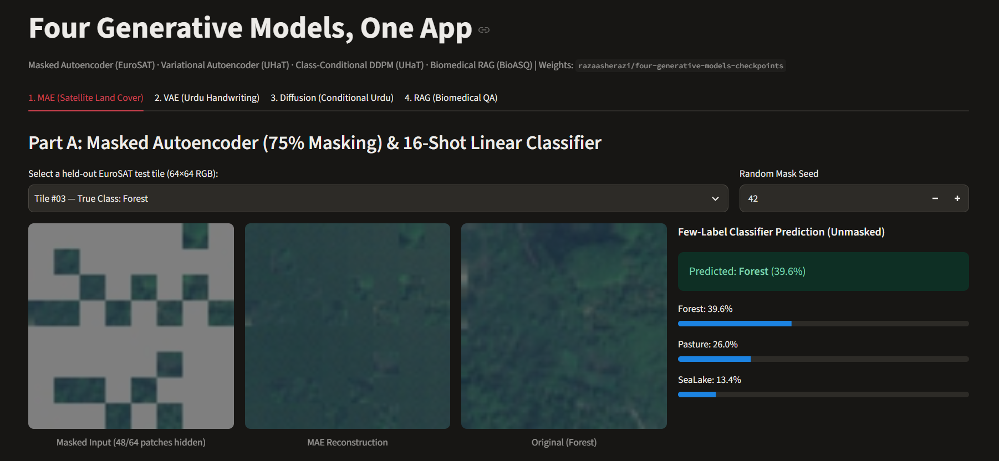

### 2. Variational Autoencoder

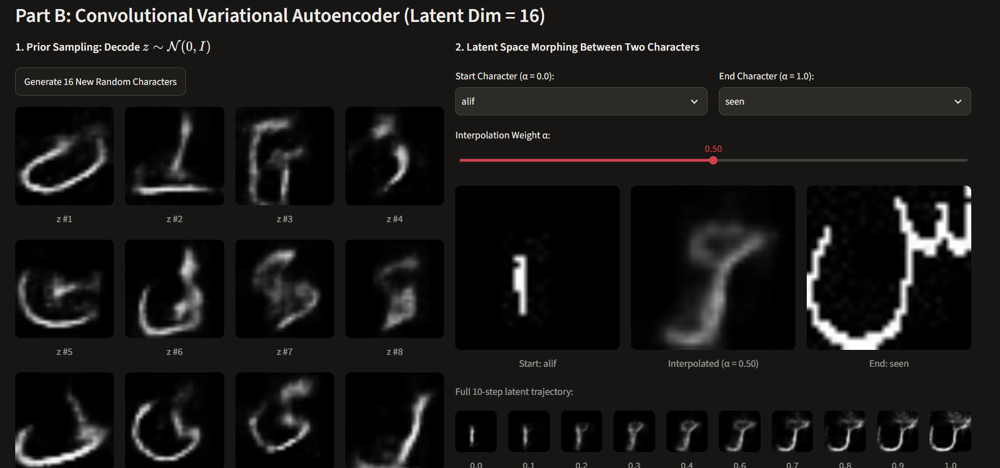

### 3. Class-Conditional Diffusion

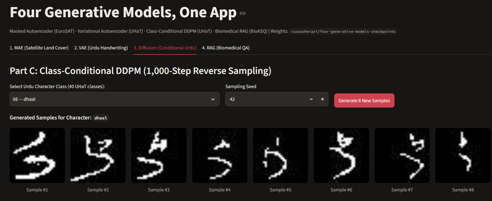

### 4. Biomedical RAG

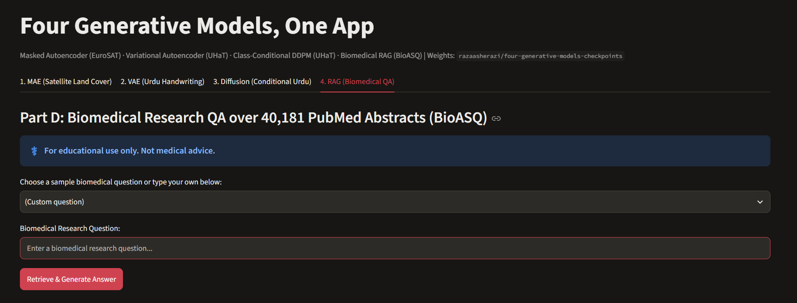

---

## Project Structure

```text
.
├── app/
│   ├── hf_loader.py
│   └── streamlit_app.py
├── part_a_mae/
│   ├── model.py
│   ├── train_mae.py
│   ├── train_classifier.py
│   └── evaluate.py
├── part_b_vae/
│   ├── model.py
│   ├── train.py
│   └── evaluate.py
├── part_c_diffusion/
│   ├── schedule.py
│   ├── model.py
│   ├── train.py
│   └── sample.py
├── part_d_rag/
│   ├── chunking.py
│   ├── index.py
│   ├── retriever.py
│   ├── generate.py
│   ├── metrics.py
│   └── evaluate.py
├── starter/
│   ├── eurosat.py
│   ├── uhat.py
│   ├── bioasq.py
│   └── viz.py
├── results/
│   ├── figures/
│   ├── tables/
│   ├── analysis.md
│   ├── samples.md
│   ├── rag_answers.jsonl
│   └── human_eval.csv
├── modal_app.py
├── pyproject.toml
└── README.md
```

---

## Hugging Face Artifacts

All pretrained weights, sample bundles, embeddings, and chunk metadata are downloaded automatically by `app/hf_loader.py`.

| Part | Artifact | Hugging Face path | Details |
|:---|:---|:---|:---|
| A | MAE encoder and decoder | `part_a_mae/mae_pretrained.pt` | 3,173,248 parameters |
| A | Few-label classifier | `part_a_mae/mae_classifier.pt` | 160 training images |
| A | EuroSAT app samples | `part_a_mae/app_test_samples.pt` | 30 held-out tiles |
| B | Convolutional VAE | `part_b_vae/vae_uhat.pt` | 220,385 parameters, latent dimension 16 |
| B | UHaT app samples | `part_b_vae/app_uhat_samples.pt` | 80 test characters |
| C | Conditional DDPM U-Net | `part_c_diffusion/ddpm_unet_uhat.pt` | 4,028,353 parameters, 40 classes |
| D | BioASQ chunk embeddings | `part_d_rag/chunk_embeddings.pt` | 79,332 x 384 matrix |
| D | BioASQ chunk metadata | `part_d_rag/chunks_metadata.pt` | Abstract IDs and chunk text |

---

## Quick Start

### 1. Clone and install

```bash
git clone https://github.com/RazaSherazi09/four-generative-models-app.git
cd four-generative-models-app
uv sync
```

### 2. Launch the Streamlit app

```bash
uv run streamlit run app/streamlit_app.py
```

The app loads checkpoints and the dense index from Hugging Face Hub on first launch and caches them locally.

---

## Reproduce Training and Evaluation

Datasets and Modal GPU pipelines are defined in `modal_app.py`. The commands below use a Modal volume for checkpoints and generated artifacts.

```bash
# Verify the starter loaders and output shapes
uv run modal run modal_app.py::task0_starter

# Train and evaluate the MAE
uv run modal run modal_app.py::part_a

# Train and evaluate the ConvVAE
uv run modal run modal_app.py::part_b

# Train and sample from the class-conditional DDPM
uv run modal run modal_app.py::part_c

# Build the BioASQ index and evaluate retrieval/generation
uv run modal run modal_app.py::part_d
```

Modal training was run on Tesla T4 and NVIDIA A10/A10G GPUs. The persistent volume is `genai-a4-models-data-vol`.

---

## Correctness Checks

The implementation includes formal sanity checks for all four parts.

### Part A: Masked-only MAE loss

```text
[MAE Correctness Check PASSED]
Batch=16 | Total patches=64 | Masked patches per image=48/64 (75.0%)
Loss delta when perturbing visible patches=0.00e+00
```

### Part B: VAE KL divergence

```text
[VAE Correctness Check PASSED]
Batch=32 | Min batch KL=16.788277 nats (>= 0 verified)
KL at (mu=0, log_sigma^2=0)=0.00e+00 nats
```

### Part C: DDPM noise schedule

```text
[DDPM Correctness Check PASSED]
T=1000 | alpha_bar_T=4.035830e-05 (approximately 4e-5 verified)
Noised x_(t=999) mean=-0.0089, std=0.9973
```

### Part D: RAG chunk and embedding checks

```text
[RAG Correctness Check PASSED]
Chunks=79332 | Max length=150 words
Max L2-norm deviation=1.79e-07
Perfect retriever: Hit@1=1.00, Recall@10=1.00, MRR@10=1.00
```

---

## Experimental Results

### Table 1: Data

| Dataset / metric | Value |
|:---|:---|
| EuroSAT train / test images; labelled images | 16,200 / 5,400; 160 labelled (16 per class) |
| UHaT character classes; train / test images | 40; 28,328 / 4,747 |
| BioASQ abstracts; chunks; test questions | 40,181; 79,332; 707 |
| Mean relevant abstracts per test question | 8.66 |

### Table 2: Training

| Model | Parameters | Final training loss | Time / GPU |
|:---|---:|---:|:---|
| MAE | 3,173,248 | 0.0067 masked MSE | 419.52 s / Tesla T4 |
| ConvVAE | 220,385 | 130.88 nats negative ELBO | 19.31 s / NVIDIA A10 |
| DDPM U-Net | 4,028,353 | 0.0225 simple MSE | 864.47 s / NVIDIA A10G |

### Table 3: Image models

| Metric | Result |
|:---|:---|
| MAE 16-shot linear classifier accuracy | 49.52% (2,674 / 5,400; 10% chance baseline) |
| VAE test negative ELBO | 131.1042 = 106.4449 reconstruction + 24.6593 KL |
| DDPM blind-test recognizability | Member 1: 38/40; Member 2: 35/40 |
| DDPM agreement between evaluators | 37/40 |

### Table 4: BioASQ retrieval

Evaluated over 707 test questions.

| Hit@1 | Hit@5 | Hit@10 | Recall@1 | Recall@5 | Recall@10 | MRR@10 |
|---:|---:|---:|---:|---:|---:|---:|
| 0.6223 | 0.8161 | 0.8614 | 0.6223 | 0.5863 | 0.6024 | 0.7061 |

### Table 5: BioASQ generation

Evaluated over the first 100 test questions.

| Metric | Result |
|:---|:---|
| ROUGE-L | 0.2275 |
| Citation precision | 0.6757 (75 / 111 citations) |
| “I don't know” rate | 16% (16 / 100) |
| Human-supported answers | Member 1: 16/20; Member 2: 15/20 |
| Human-correct answers | Member 1: 16/20; Member 2: 13/20 |

The complete tables are available in [results/tables/results_tables.md](results/tables/results_tables.md).

---

## Figures

### Masked Autoencoder

| Pretraining loss | Reconstructions | Confusion matrix |
|:---:|:---:|:---:|
| 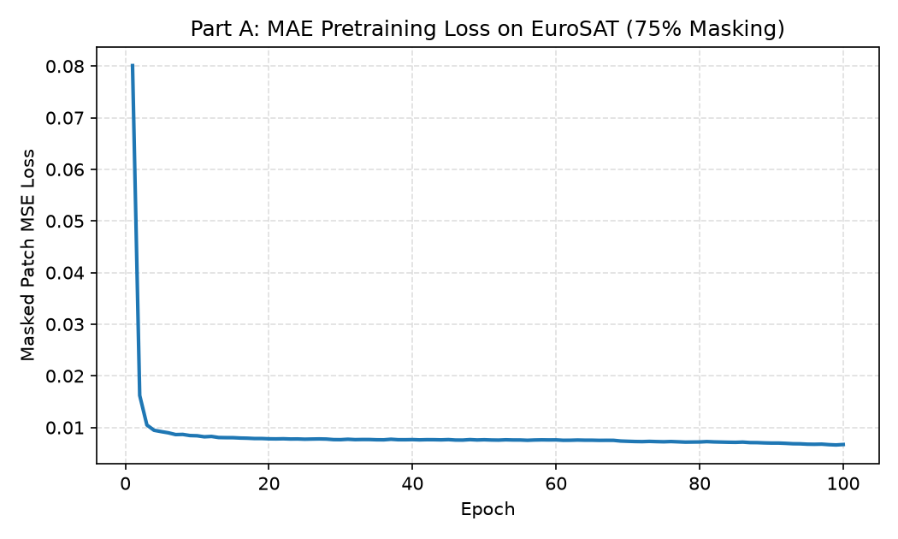 | 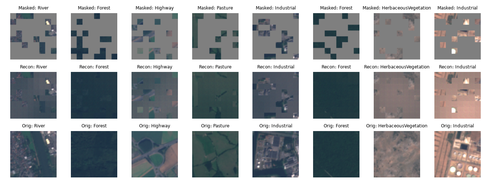 | 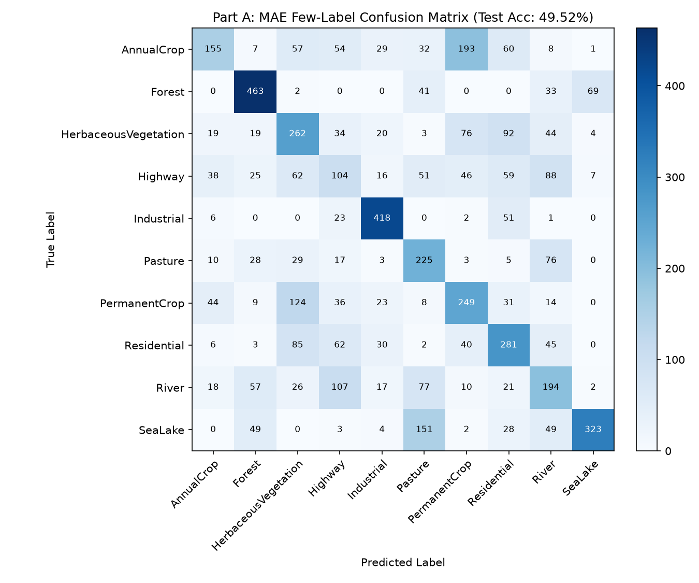 |

### Convolutional VAE

| Loss terms | Reconstructions | Prior samples | Latent interpolation |
|:---:|:---:|:---:|:---:|
| 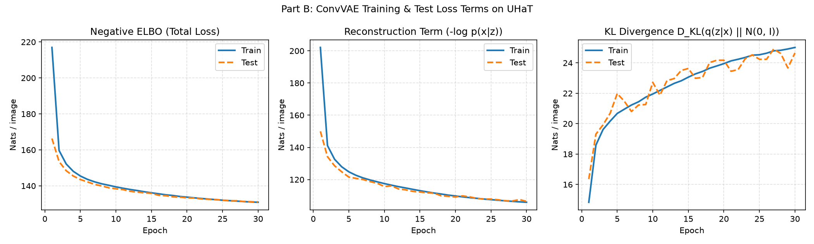 | 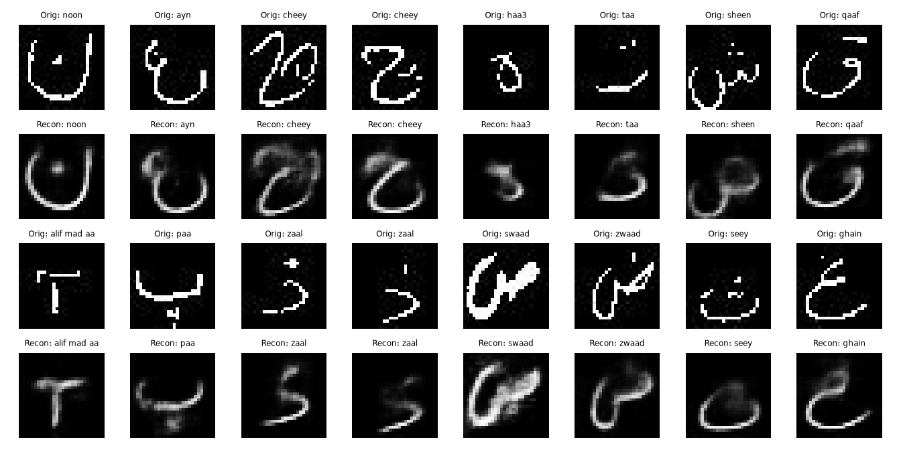 | 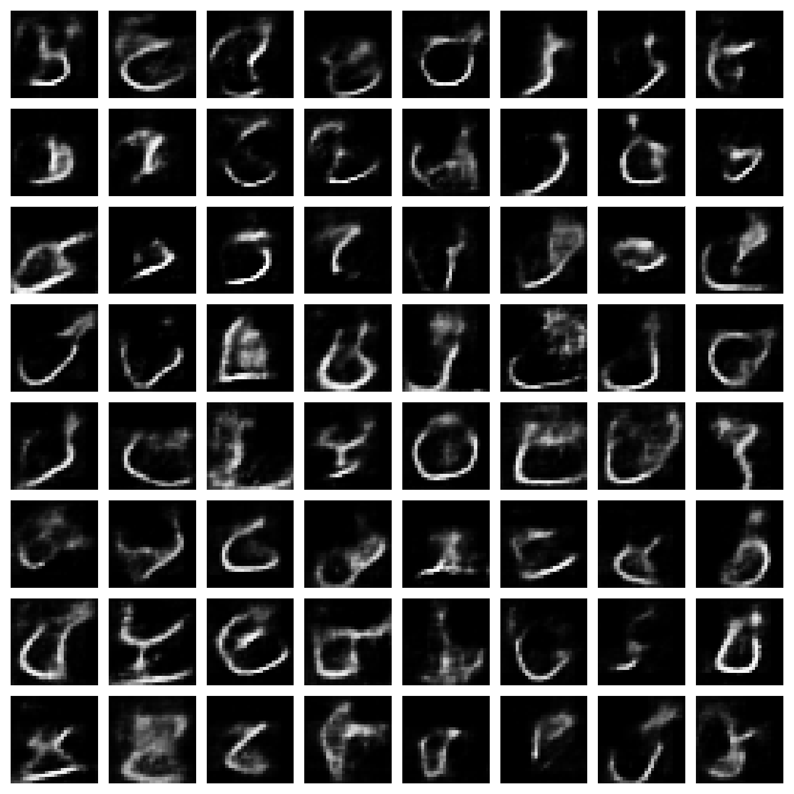 | 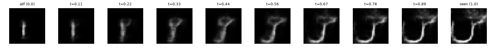 |

### Class-Conditional DDPM

| Forward noising | Conditional samples | Denoising trajectory |
|:---:|:---:|:---:|
| 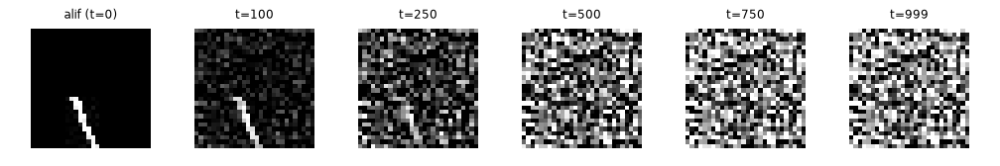 | 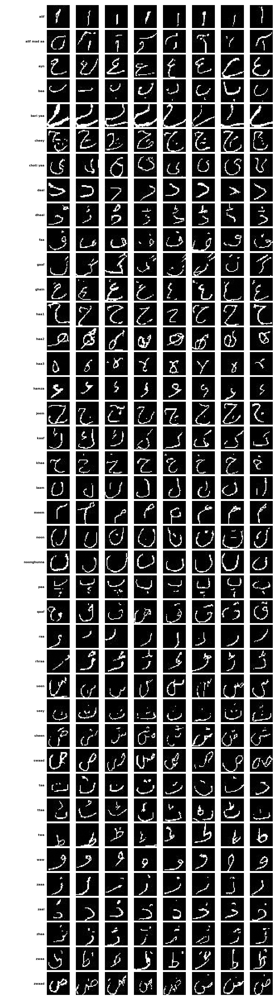 | 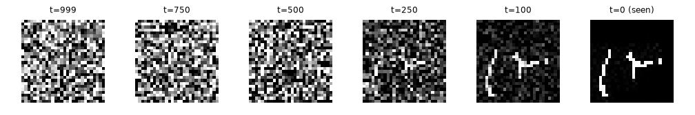 |

### Biomedical RAG

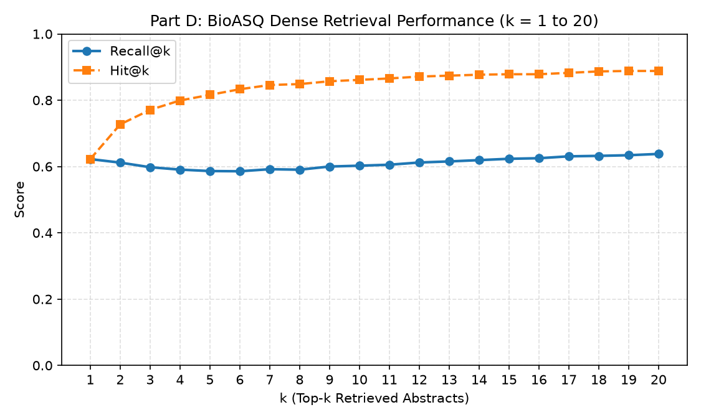

Additional qualitative samples and experimental analysis:

- [RAG qualitative samples](results/samples.md)
- [Experimental analysis: E.1–E.7](results/analysis.md)
- [Generated RAG answers](results/rag_answers.jsonl)
- [Human evaluation annotations](results/human_eval.csv)

